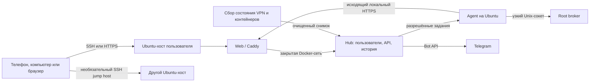

# Архитектура SovaGrid

## Компоненты

**Hub** отвечает за локальные учётные записи, роли, API, историю метрик, тревоги, Telegram, очередь заданий и аудит. Каждый Ubuntu-хост может иметь собственные Hub, Agent, базу и пользователей. Общий аккаунт SovaGrid не нужен. Один Hub может дополнительно наблюдать другие Agent, если администратор явно их подключил.

**Agent** работает как непривилегированная служба Ubuntu. Он сам соединяется с Hub, передаёт метрики и получает только разрешённые задания. Команды, терминал, файлы, журналы и управление службами выключены до отдельного включения на Hub и на хосте Agent. Root-брокеры получают точные структурированные запросы через Unix-сокеты; Hub и Agent не получают общий root или Docker socket.

**Нативные клиенты** открывают SSH по паролю или ключу, проверяют host key до передачи данных, запускают терминал и временный локальный проброс к панели. При промежуточном SSH-хосте каждый ключ и учётная запись проверяются отдельно. Клиент различает пустую Ubuntu, управляемый Hub, Agent-only узел и конфликтную частичную установку. Root/sudo SSH на сервере с Hub может выдать одноразовый короткий пропуск для местного администратора; отдельный пароль Hub остаётся доступен.

**Web/PWA** обращается к Hub через Caddy в отдельной Docker-сети. По умолчанию панель слушает loopback Ubuntu и доступна через SSH. Владелец может отдельно включить публичный HTTPS по собственному домену или статическому IP, выбрать путь панели и поведение `/`. Публичный маршрут не принимает Agent-токен и не открывает внутренние worker API.

**VPN-инвентарь** на хосте Hub раздельно читает собственный WireGuard и известные Amnezia-контейнеры, затем сохраняет очищенный снимок без ключей и адресов клиентов. Для действий над WireGuard Hub ставит структурированное задание с ключом идемпотентности, Agent обращается к ограниченному root-брокеру, а брокер повторно проверяет права и состояние. Существующая Amnezia не изменяется обычной установкой; отдельное управление включается после принятия конкретного контейнера и root-политики.

## Потоки доверия

- SSH-ключ каждого хоста закрепляется отдельно; неожиданная смена прерывает вход.
- Пароль SSH и приватный ключ не сохраняются в Hub при прямом SSH-подключении.
- Сеанс Hub выдаётся после местного пароля или одноразового пропуска, созданного через root/sudo SSH на том же сервере. Пропуск нельзя выпустить через HTTP.
- Роли Hub и локальные разрешения Agent проверяются независимо. Структурированные задания не превращаются в произвольные shell-команды root.
- Telegram-бот связывает числовой `user_id` и личный `chat_id`; команды требуют административной роли, отдельного подтверждения и аудита.
- Секреты не должны попадать в репозитории, URL, браузерный localStorage и сообщения инцидентов.

## Ограничение наблюдения

Hub и Agent на одном Ubuntu-сервере видят сбои процессов и ресурсов, пока хост работает. При полном отключении этого хоста сам Hub не отправит тревогу; для такого случая нужен внешний наблюдатель на другом управляемом хосте. Текущие и будущие функции перечислены в [ROADMAP.md](ROADMAP.md).
